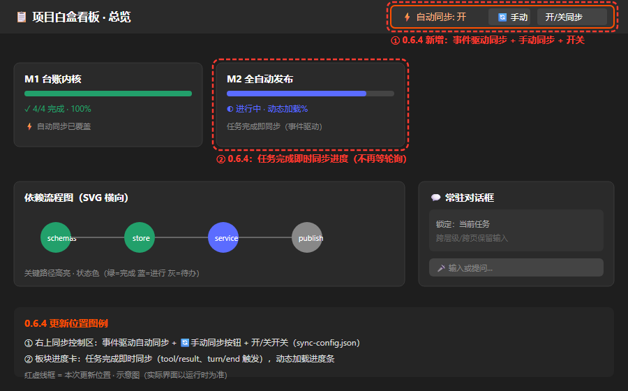
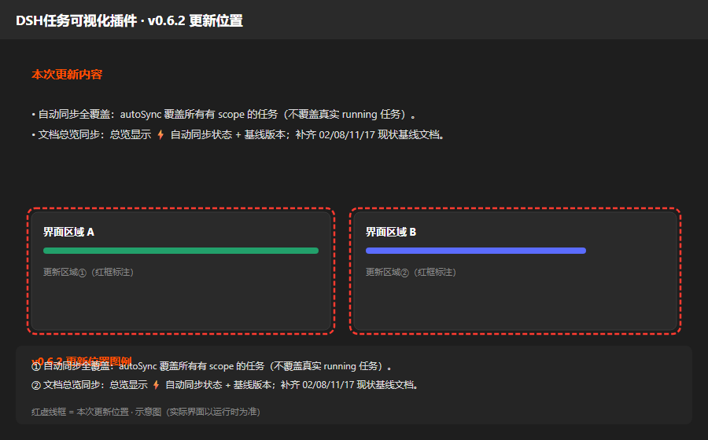
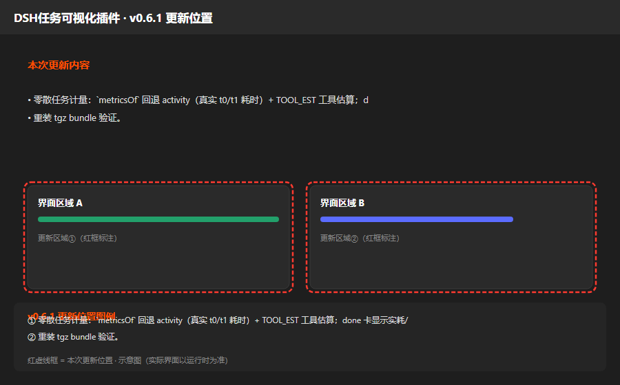
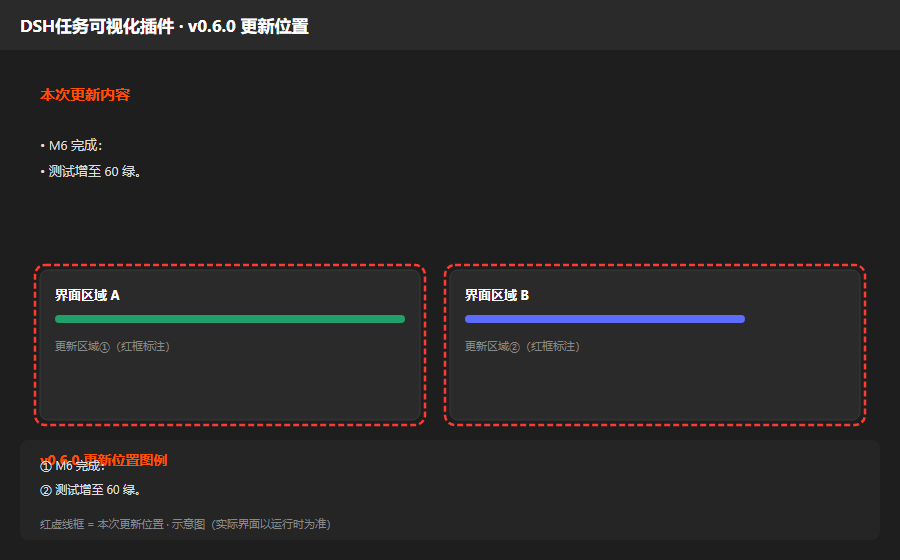
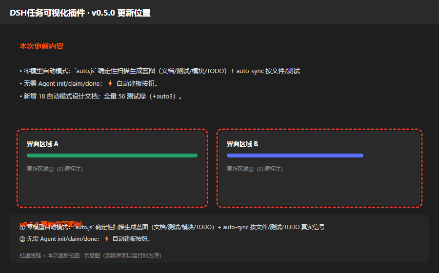
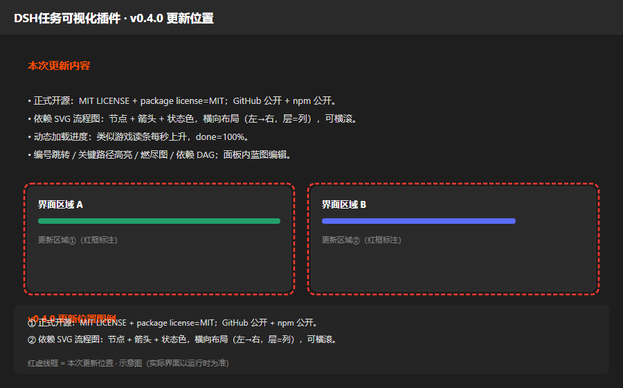

# Changelog

本文件记录 `@chendb888/dsh-project-board`（项目白盒看板）逐版本变更。
格式参考 [Keep a Changelog](https://keepachangelog.com/)，版本遵循 [SemVer](https://semver.org/)。
迭代内部编号（V2.x）与发布版本对照见 `docs/baseline/16_迭代变更记录与现状基线.md`。

## [0.6.11] - 2026-11-28

### Fixed
- **投影依赖字段防御**：`dependsOn`/`scope` 非数组（误传字符索引对象）时安全规范化，修复板块依赖图崩溃致视图空白。
- **task_add 入口规范化**：依赖/范围自动转数组。

### Changed
- 投影 stateVersion 升级触发干净重建，蓝图结构变更即时生效。

## [0.6.4] - 2026-11-22

### Added
- **事件驱动自动同步**：投影在 `tool/result`、`turn/end`、`assistant/message` 即时触发 autoSync，任务完成即同步进度（不再仅靠 20s 轮询）。
- **同步开关 + 手动同步**：`sync-config.json` 控制自动同步开/关；总览面板新增 🔄 手动同步与开/关按钮；20s 轮询作为备份。

### Changed
- 自动同步与手动/事件驱动协同，避免重复刷新。

### 更新位置

① 右上同步控制区（事件驱动同步 + 🔄手动 + 开/关）；② 板块进度卡（任务完成即时同步 + 动态进度条）。红虚线框 = 更新区域。

## [0.6.3] - 2026-11-22

### Added
- 补充 **README.md**（功能特性 + 安装 + 使用 + 版本更新说明）与 **CHANGELOG.md**（逐版本变更），纳入 npm 发布文件。
- 完善上架材料：用户可在 npm/GitHub/DSH 市场看到完整项目说明与更新内容。

## [0.6.2] - 2026-11-22

### Added
- **自动同步全覆盖**：autoSync 覆盖所有有 scope 的任务（不覆盖真实 running 任务）。
- **文档总览同步**：总览显示 ⚡ 自动同步状态 + 基线版本；补齐 02/08/11/17 现状基线文档。

## [0.6.1] - 2026-11-22

### Added
- **零散任务计量**：`metricsOf` 回退 activity（真实 t0/t1 耗时）+ TOOL_EST 工具估算；done 卡显示实耗/估算。

### Changed
- 重装 tgz bundle 验证。

## [0.6.0] - 2026-11-22

### Added
- **M6 完成**：
  - `auto-enh`：模块按测试覆盖/构建信号判定 done。
  - `spd`：领域模板（web-app / library / docs / default）+ PDF 文本提取建板。
- 测试增至 60 绿。

## [0.5.0] - 2026-11-22

### Added
- **零模型自动模式**：`auto.js` 确定性扫描生成蓝图（文档/测试/模块/TODO）+ auto-sync 按文件/测试/TODO 真实信号判进度（20s）。
- 无需 Agent init/claim/done；⚡ 自动建板按钮。
- 新增 18 自动模式设计文档；全量 56 测试绿（+auto3）。

## [0.4.0] - 2026-11-21

### Added
- **正式开源**：MIT LICENSE + package license=MIT；GitHub 公开 + npm 公开。
- **依赖 SVG 流程图**：节点 + 箭头 + 状态色，横向布局（左→右，层=列），可横滚。
- **动态加载进度**：类似游戏读条每秒上升，done=100%。
- **编号跳转 / 关键路径高亮 / 燃尽图 / 依赖 DAG**；面板内蓝图编辑。
- **最新对话即时可见**：tool/call 即刻记入活动流（running）。
- **导游即场交互**：每层级 🧭 卡问答框（输入+问+🎤）→ /api/ask → 质量门 → answer。
- **对话框常驻**：跨层级/跨页保留真实 composer，锁定当前任务上下文。
- **真实用量计量**：对接 DSH sessionTokens（去重 input+output）；metrics.json 持久化每任务实耗/用量/状态，跨会话准确；移除假 20k 预估。

### Fixed
- 右栏文件夹按钮（web 无桌面桥接）→ 改开右栏文件浏览。
- 二层对话框缺输入 → 保留 composer 引用重搬。

## [0.2.0] - 2026-11-20

### Added
- **语音输入**（SpeechRecognition → composer）+ **自动播报**（speechSynthesis 读新回复）。
- 零散任务面板改"做过+当前按时间序"（activity 卡 + live + adhoc），当前第一、做过最新在前。
- "增强"改"小工具"大白话说明；依赖关系用任务标题逐行显示「先做《X》→才能做《Y》」。

## [0.1.0] - 2026-11-20

### Added
- 首次正式发布到 npm（`@chendb888/dsh-project-board`，scope 防占名）。
- 蓝图初始化（`project_init` / `project_bootstrap`，文档门控）。
- 实时白盒看板：任务卡、进度环、板块分组、散任务时间序。
- 代码下钻：编辑卡 + diff、编号跳转、可点击开文档。
- 人工确认/重开闸门、证据门（无证据不得 done）。
- 导游解说旁路（因果链）。

---

## 维护说明（Maintenance）

### 版本发布流程
1. 改动代码后跑测试：`node --test`（当前 60 绿）。
2. 更新本 CHANGELOG（新增版本条目）+ README 版本更新说明 + `docs/baseline/16_迭代变更记录`（V2.x 对照）。
3. bump `package.json` version（patch 自动 +0.0.1，遵循 SemVer）。
4. staging 公开包：`@chendb888/dsh-project-board`（去 private），`npm pack --dry-run` 核对文件清单（须含 README/CHANGELOG/locale/icon）。
5. `npm publish --registry=https://registry.npmjs.org --access public`（token 需 package write + bypass 2fa）。
6. 推 GitHub + 更新官方市场条目（awesome-dsh-plugin 目录，PR 合并即上架）。
7. 发布后核实：npm readme 非空、镜像同步、市场条目描述完整。

### 上架材料清单（发布说明硬门禁）
- **README.md**：功能 + 安装 + 使用 + 版本更新说明（npm 自动展示）。
- **CHANGELOG.md**：逐版本变更。
- **locale/en.json + zh.json**：meta.title / meta.description。
- **icon.svg**：图标。
- **GitHub**：description + topics + 根目录 README/CHANGELOG。
- 缺 README/CHANGELOG 不得发布（项目管家 FR2.9 门禁）。

### 数据与兼容
- 蓝图结构落盘 `.dsh-project/`；运行时状态以会话事件日志为唯一事实源。
- 投影 `stateVersion` 升级会触发干净重建（蓝图结构变更时递增）。
- 依赖字段 `dependsOn`/`scope` 须为数组（投影已做防御规范化）。
- 卸载不删除项目内 `.dsh-project/` 数据。

### 已知限制
- HTTP 路由（`/project-board/api/*`）已有同源校验；官方市场曾标注需 DSH 访问检查，后续可加鉴权。
- 自动同步不覆盖真实 running 任务，避免与 Agent 操作冲突。

## 许可

MIT