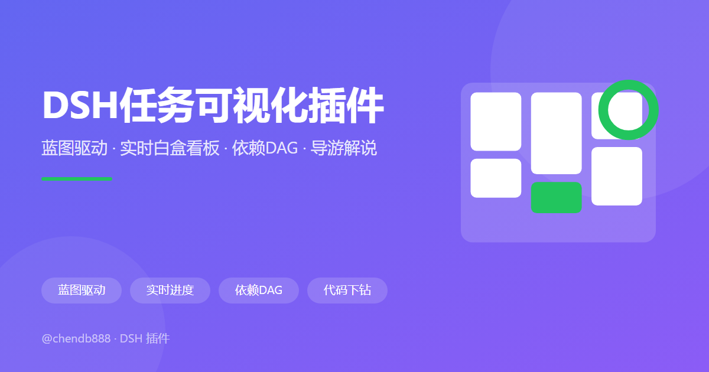
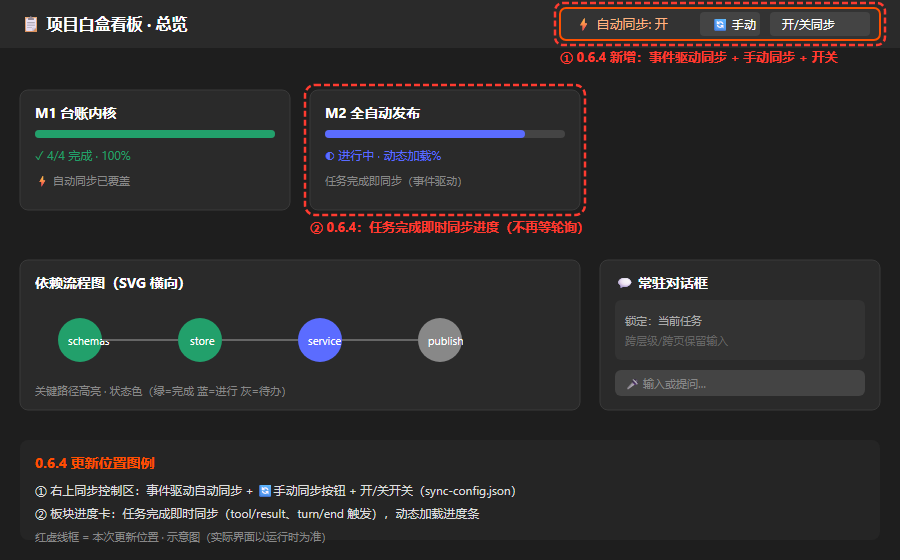

# dsh-project-board · 项目白盒看板



> 领域无关的 DSH 项目可视化插件：蓝图驱动即时布局、实时任务状态/进度/ETA、代码下钻（编辑卡+diff）、依赖 DAG、关键路径、燃尽图、导游旁路。像经营店铺一样看清你的项目全貌。

## 功能特性

- **蓝图驱动看板**：`project_init` / `project_bootstrap` 结构化分解（板块→任务树+依赖+验收+scope+估算），文档门控。
- **实时白盒看板**：任务卡、进度环、板块分组、散任务时间序；状态/当前动作/ETA 实时刷新。
- **代码下钻**：点入代码/编辑卡（可点击开文档）、编号跳转、diff 预览。
- **依赖可视化**：依赖 DAG（SVG 流程图）、关键路径高亮、燃尽图。
- **人工确认闸门**：蓝图编辑、人工确认/重开、证据门（无证据不得 done）。
- **导游解说**：因果链旁路解说（为什么这样设计/卡在哪/下一步）。
- **语音交互**（0.2.0+）：语音输入（SpeechRecognition→composer）+ 自动播报（speechSynthesis 读新回复）。
- **重启不丢态**：状态从会话事件日志重建，DSH 重启/会话 fork 后看板完整恢复。

## 安装

```bash
dsh plugin --profile web add @chendb888/dsh-project-board
```

或在 DSH 插件管理器安装 `@chendb888/dsh-project-board`。

## 使用

1. 在项目目录对话：`project_bootstrap` 扫描生成蓝图（文档先行）或 `project_init` 手动分解。
2. 人工确认蓝图后，`task_claim` 领取任务、`task_done` 附证据完成。
3. 打开「看板」视图页签查看实时进度、依赖 DAG、关键路径。
4. 点任务卡下钻代码/编辑卡；导游旁路提供因果解说。

## 版本更新说明

### 0.6.4（2026-11-22）
- ⚡ **事件驱动自动同步**：任务完成即同步进度（tool/result、turn/end 即时触发），不再仅靠轮询。
- 🔄 **同步开关 + 手动同步**：sync-config 控制自动同步，总览面板手动同步按钮。

**更新位置示意**（红虚线框标注本次更新区域）：



> ① 右上同步控制区（事件驱动同步 + 🔄手动 + 开/关）；② 板块进度卡（任务完成即时同步 + 动态进度条）。

### 0.6.2（2026-11-22）
- 🔁 **自动同步全覆盖**：覆盖所有有 scope 的任务（不覆盖真实 running）；总览显示自动同步状态 + 基线版本。

### 0.6.1（2026-11-22）
- 📊 **零散任务计量**：真实耗时回退 + 工具估算，done 卡显示实耗/估算。

### 0.6.0（2026-11-22）
- 🧩 **M6 完成**：模块按测试覆盖/构建信号判 done；领域模板（web-app/library/docs）+ PDF 文本提取建板。

### 0.5.0（2026-11-22）
- 🤖 **零模型自动模式**：确定性扫描生成蓝图（文档/测试/模块/TODO）+ 按真实信号自动判进度，无需 Agent 操作；⚡ 自动建板。

### 0.4.0（2026-11-21）
- 🌐 **正式开源**（MIT）；依赖 **SVG 流程图**（横向）、**动态加载进度**、编号跳转/关键路径/燃尽图/依赖 DAG。
- 🧭 **导游即场问答**；**对话框常驻**跨层级保留；**真实用量计量**（对接 DSH sessionTokens，metrics.json 持久化）。

### 0.6.3（2026-11-22）
- 📝 补充 **README + CHANGELOG** 项目说明并纳入 npm 发布，用户可在 npm/GitHub/市场看到完整功能与更新内容。

### 0.2.0（2026-11-20）
- 🎤 **语音输入** + **自动播报**；零散任务按时间序；依赖用任务标题逐行显示。

### 0.1.0（2026-11-20）
- 🎉 首次正式发布到 npm（`@chendb888/dsh-project-board`）。
- 蓝图初始化、实时白盒看板、代码下钻、编号跳转、关键路径、燃尽图、依赖 DAG、面板内蓝图编辑、人工确认/重开闸门、导游解说。

> 完整逐版本变更见 [`CHANGELOG.md`](CHANGELOG.md)；迭代内部编号（V2.x）对照见 [`docs/baseline/16_迭代变更记录与现状基线.md`](docs/baseline/16_迭代变更记录与现状基线.md)。

## 维护说明

- **发布流程**：改代码 → `node --test`（60 绿）→ 更新 CHANGELOG/README/迭代记录 → bump version → staging 公开包（`npm pack --dry-run` 核对含 README/CHANGELOG/locale/icon）→ `npm publish --registry=https://registry.npmjs.org` → 推 GitHub + 更新市场条目 → 核实 npm readme 非空/镜像同步。
- **上架材料硬门禁**：README + CHANGELOG + locale(en/zh) + icon 必备，缺失不得发布。
- **数据兼容**：蓝图落盘 `.dsh-project/`；状态以会话事件日志为事实源；投影 stateVersion 升级触发干净重建；dependsOn/scope 须为数组。
- 详见 [`CHANGELOG.md` 维护说明节](CHANGELOG.md#维护说明maintenance)。

## 数据与隐私

- 蓝图结构落盘项目目录 `.dsh-project/`；运行时状态以会话事件日志为唯一事实源。
- 卸载不删除项目内 `.dsh-project/` 数据。

## 许可

MIT